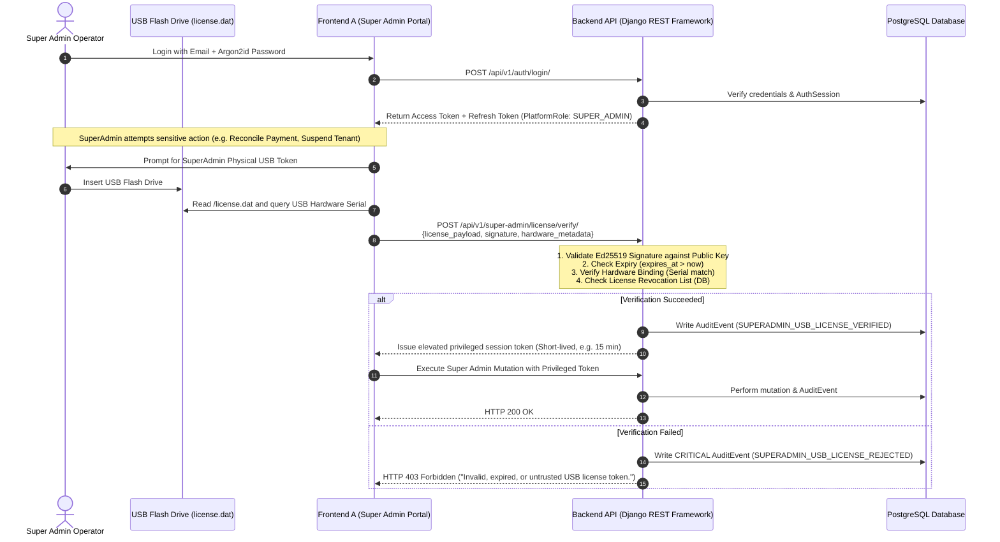

# PBMS SaaS — Mandatory SuperAdmin USB Hardware Licensing Specification

> **Status:** Approved Mandatory Specification  
> **Classification:** Mandatory Security Invariant & Platform Capability  
> **Hardware Implementation:** Standard Consumer USB Flash Drive (Flash Thumb Drive) formatted as a Custom Cryptographic Dongle (No expensive commercial dongles like YubiKey/Sentinel/HASP required).  
> **Enforcement:** Core Platform Requirement — Must never be removed, skipped, or weakened.

---

## 1. Executive Summary & Core Objective

The **SuperAdmin USB Hardware Licensing Feature** is a mandatory, non-negotiable security requirement for the PBMS SaaS platform. It establishes a hardware-bound possession factor for platform SuperAdmins, ensuring that administrative actions across the platform (such as tenant activation, billing reconciliation, system configuration, database backup/restore drills, and emergency support) require physical possession of a cryptographically signed hardware license token (`license.dat`).

### Practical Hardware & Cost Constraint
- **No expensive commercial dongles required:** Enterprise hardware security modules/dongles (e.g., YubiKey, SafeNet, HASP) are cost-prohibitive.
- **Consumer USB Flash Drive Implementation:** The platform converts any standard, inexpensive consumer USB flash drive (Thumb Drive) into a secure cryptographic dongle by cryptographically binding the license signature to the USB drive's physical hardware attributes (Volume Serial Number, Device Hardware ID, and Vendor/Product ID).

---

## 2. Inviolable Security Invariants

1. **Zero Security Bypass (Defense-in-Depth):**
   - The USB license is strictly an **additional authorization / possession factor**.
   - It **CANNOT** bypass username/password login, Argon2id hashing, session token generation, Platform RBAC (`SUPER_ADMIN` check), Tenant Isolation boundaries, or Audit Logging.
   - Both valid credentials **AND** a valid cryptographically verified USB license are required for SuperAdmin operations.

2. **Asymmetric Key Separation:**
   - The **Private Signing Key** (`SUPERADMIN_LICENSE_PRIVATE_KEY`) is stored strictly in the platform root environment / KMS / HSM and is **NEVER** copied to or stored on the USB drive.
   - The USB drive contains only the public payload and cryptographic signature (`license.dat`).
   - The Backend API uses the **Public Verification Key** (`SUPERADMIN_LICENSE_PUBLIC_KEY`) to verify authenticity.

3. **Independent Server-Side Authorization:**
   - The backend API independently validates the license signature, hardware fingerprint, expiry timestamp, and revocation status on every privileged SuperAdmin operation or during privileged session elevation.
   - The frontend never performs client-side-only verification.

4. **Fail-Closed Principle:**
   - Missing USB drive, missing `license.dat`, signature mismatch, expired license, or revoked license key ID immediately results in `HTTP 403 Forbidden` with a critical `AuditEvent` logged.

---

## 3. Cryptographic Design & Payload Specification

### 3.1 Algorithm
- **Signature Algorithm:** `Ed25519` (Edwards-curve Digital Signature Algorithm, RFC 8032) or `RSA-PSS` with SHA-256 (minimum 4096-bit). `Ed25519` is strongly recommended for its high security, resistance to side-channel attacks, and compact signature size.

### 3.2 File Structure (`license.dat`)
The USB flash drive root directory contains a single signed file: `/license.dat` (or structured JSON / binary envelope):

```json
{
  "version": "1.0",
  "license_id": "lic_9f83a21b-4c28-4e89-b021-d41a774b9981",
  "issuer": "PBMS SaaS Platform Security Authority",
  "issued_to_email": "admin@pbms.local",
  "hardware_binding": {
    "volume_serial_number": "A4B2-7F91",
    "usb_vendor_id": "0x0781",
    "usb_product_id": "0x5583",
    "usb_serial_number": "4C530001230415112345"
  },
  "permissions": [
    "platform:super_admin",
    "platform:tenant_lifecycle",
    "platform:payment_reconcile",
    "platform:dr_restore_drill",
    "platform:system_settings"
  ],
  "valid_from": "2026-01-01T00:00:00Z",
  "expires_at": "2027-01-01T00:00:00Z",
  "signature_algorithm": "ED25519",
  "signature": "c03f56a8...[64-byte Ed25519 hex-encoded signature]..."
}
```

---

## 4. Operational Flow & Verification Lifecycle



---

## 5. Security Threat Model & Mitigations

| Threat Vector | Mitigation Strategy |
| :--- | :--- |
| **Cloned USB File** | The file is cryptographically bound to the physical USB volume serial / hardware device ID. A raw copied file on a different USB fails hardware binding validation. |
| **Tampered License (Expiry Extension)** | Any byte alteration invalidates the Ed25519 digital signature. The private key remains secure on the platform server. |
| **Stolen USB Drive** | Physical possession alone is useless without valid SuperAdmin email + password (Argon2id). |
| **Stolen Admin Credentials** | Remote attackers cannot execute SuperAdmin privileged mutations without physical insertion of the signed USB drive. |
| **Compromised USB Key** | The platform database maintains a `SuperAdminRevokedLicense` blacklist. Revoking a `license_id` invalidates it immediately. |

---

## 6. Acceptance Criteria for Implementation

- [ ] Management command `python manage.py provision_usb_flash --drive <DriveLetter> --email <AdminEmail>` that:
  - Scans and detects the inserted standard consumer USB Flash Drive.
  - Queries its physical Volume Serial Number and hardware device descriptors.
  - Generates the signed `license.dat` using the platform's private key (`Ed25519`).
  - Writes `license.dat` directly to the root of the USB Flash Drive.
- [ ] Endpoint `/api/v1/super-admin/license/verify/` validates signature, hardware serial, and expiration.
- [ ] Privileged SuperAdmin endpoints require `HasVerifiedUsbLicense` permission class.
- [ ] Full automated negative test suite testing:
  - Missing file / missing USB
  - Tampered payload
  - Expired timestamp
  - Hardware serial mismatch (preventing file cloning across different USB drives)
  - Revoked `license_id`
  - Replay attempts
- [ ] Frontend A (Super Admin Portal) UI integrates USB license detection, status indicator, and license expiration warning.

