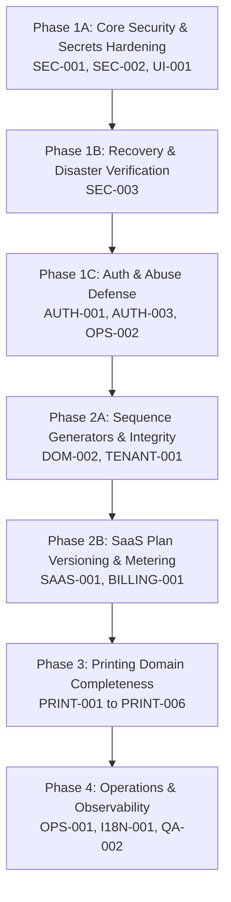

# PBMS SaaS — Master Audit Validation Report

---

## 1. Repository Identity and Git Baseline

- **Current Branch:** `feat/task-04-production-settings-hardening-11635122478871391506`
- **Current HEAD Commit:** `8a5d14c9d743442f9195e3de3dd324676b086ad1` (`fix(billing): prevent unpaid subscription reactivation`)
- **Tracking Branch:** `origin/feat/task-04-production-settings-hardening-11635122478871391506` (in sync)
- **Worktree Status:** Clean relative to tracked files; single untracked directory `docs/audits/` (preserved untouched)
- **Operational Mode:** Read-Only Audit (no migrations run, no seeds executed, no files created/modified/deleted, no Git mutation)

---

## 2. Validation Summary

The existing `MASTER_AUDIT_REPORT_AND_IMPLEMENTATION_ROADMAP.md` correctly establishes that PBMS SaaS is not yet ready for production deployment. However, our code-level inspection reveals:

- **Under-reported Discrepancies between Docs and Reality:** Documentation in `docs/DATABASE.md` outlines a multi-app architecture (`apps.catalog`, `apps.sales`, `apps.production`, `apps.inventory`, `apps.finance`), line-item models (`QuotationItem`, `SalesOrderItem`), and printing service templates (`PrintingService`). The actual codebase collapsed all of these into a single monolithic `apps.operations` app containing flat, single-item models with no service catalog, no line items, and no file models.
- **Health Check Defect:** The `/api/v1/health/` endpoint is a static view that does not verify PostgreSQL connectivity or service dependencies.
- **Sequence Allocation Fragility:** Order, job, invoice, and quotation number generators rely on table row counts (`count() + 1`) rather than database sequences or dedicated counters, risking race conditions and sequence collisions if records are deleted or entered out-of-band.
- **Localization Corruption:** UI templates in the Angular applications have corrupted UTF-8 question marks (`?????????`) for Khmer copy while displaying demo credentials directly in the login forms.

---

## 3. Confirmed Findings with Evidence

Every finding has been evaluated against concrete code evidence and classified into standard audit buckets:

### P0 — Critical Security, Data Integrity, and Recovery

#### SEC-001: JWT Signing Key Insecure Fallback
- **Classification:** Confirmed Defect
- **Evidence:** In `backend/apps/accounts/jwt_service.py`, `_get_signing_key()` falls back to `settings.SECRET_KEY` if `JWT_SIGNING_KEY` is not present in the environment (`return os.getenv("JWT_SIGNING_KEY", settings.SECRET_KEY)`). Unlike `DJANGO_SECRET_KEY` in `backend/config/settings.py`, there is no fail-closed check for `JWT_SIGNING_KEY` when `DEBUG=False`.

#### SEC-002: Hardcoded Backup Passphrase Fallback & Insecure Encryption Mode
- **Classification:** Confirmed Defect
- **Evidence:** In `ops/backup_postgres.ps1` and `ops/verify_restore.ps1`, `$env:PBMS_BACKUP_PASSPHRASE` defaults to a hardcoded string (`LocalDevOnly-Backup-Passphrase-ChangeInProd-2026`). Furthermore, the encryption implementation uses AES-256-CBC without AEAD (such as GCM) or an HMAC, providing confidentiality but not authenticated ciphertext integrity.

#### SEC-003: Missing Backup Manifest, Retention Pruning, and Catalog Validation
- **Classification:** Confirmed Defect / Missing Capability
- **Evidence:** `docs/BACKUP.md` specifies writing a JSON manifest entry, automatic 30-day retention pruning after successful verification, `pg_restore --list` validation, and writing a `BACKUP_RESTORE_VERIFIED` audit log to `core_auditevent`. None of these features exist in `ops/backup_postgres.ps1` or `ops/verify_restore.ps1`.

---

### P1 — Identity, Authorization, and SaaS Correctness

#### AUTH-001: Missing Throttling / Rate-Limiting on Authentication and Registration Endpoints
- **Classification:** Confirmed Defect
- **Evidence:** In `backend/config/settings.py`, `REST_FRAMEWORK` does not configure `DEFAULT_THROTTLE_CLASSES` or `DEFAULT_THROTTLE_RATES`. In `backend/apps/accounts/views.py`, both `LoginAPIView` and `RefreshTokenAPIView` specify `permission_classes = [AllowAny]` without any `throttle_classes`. In `backend/apps/subscriptions/views.py`, `PublicTenantRegistrationAPIView` also lacks rate limiting.

#### AUTH-002: Missing Account Recovery and Verification Workflows
- **Classification:** Missing Capability
- **Evidence:** The URL configuration in `backend/apps/accounts/urls.py` and `backend/config/urls.py` exposes no password reset, password recovery, email verification, or staff invitation acceptance endpoints.

#### AUTH-003: Session-Wide Revocation Incomplete
- **Classification:** Confirmed Defect / Missing Capability
- **Evidence:** While `apps/accounts/authentication.py` correctly validates `session.is_revoked` and `session.user.is_active` on every request, `apps/accounts/views.py:LogoutAPIView` only marks the single active session as revoked (`request.auth.is_revoked = True`). There is no endpoint or mechanism to revoke all sessions for a user upon password reset or security compromise.

#### TENANT-001: Multi-Tenant Relationship Integrity and Sequence Generation
- **Classification:** Confirmed Defect & Fragile Implementation
- **Evidence:**
  - **Cross-tenant object referencing:** In `apps/operations/views.py:QuotationListCreateAPIView`, customer tenant ownership is checked via `get_object_or_404(Customer, id=data["customer_id"], tenant=locked_tenant)`. However, `Quotation.quote_number` is generated via `seq = Quotation.objects.filter(tenant=locked_tenant).count() + 1` (L264).
  - **Sequence Collisions:** Similarly, in `apps/operations/services.py:convert_quotation_to_order_and_invoice`, `seq_num = SalesOrder.objects.filter(tenant=locked_tenant).count() + 1`, generating `SO-{seq_num:04d}`, `JOB-{seq_num:04d}`, and `INV-{seq_num:04d}`. If an entity is deleted or archived, `.count() + 1` will collide with existing records, violating unique constraints (`uq_tenant_order_number`, `uq_tenant_invoice_number`).

#### RBAC-001: Platform Support and View Permission Consistency
- **Classification:** Missing Capability
- **Evidence:** `apps/tenants/permissions.py:IsPlatformSuperAdminOrSupportReadOnly` is defined, but platform-wide support impersonation or audited access into tenant operational data is not implemented in any backend service.

#### SAAS-001: Incomplete Plan Entitlements and Plan Versioning
- **Classification:** Missing Capability
- **Evidence:** In `apps/subscriptions/models.py`, `Plan` only tracks `max_staff_users` and `max_orders_per_month`. There is no `PlanVersion` model, no storage quota tracking, no feature flag gating, and no upgrade/downgrade proration logic.

#### BILLING-001: Subscription Lifecycle and Real Payment Gateways
- **Classification:** Missing Capability
- **Evidence:** Subscriptions only support manual reconciliation (`SuperAdminPaymentReconcileAPIView`) and mock providers. There are no automated renewal/cancellation background tasks, no webhook endpoints with signature validation for external gateways (e.g., Bakong KHQR Open API), and no automated transition to `PAST_DUE` upon billing period expiration.

#### UI-001: Demo Credential Hardcoding in Production UI Components
- **Classification:** Confirmed Defect
- **Evidence:** In `frontend/projects/super-admin/src/app/app.component.ts` and `frontend/projects/tenant-workspace/src/app/app.component.ts`, default component properties pre-fill passwords (`admin@pbms.local` / `Admin@PBMS2026` and `Owner@PBMS2026`). In their corresponding templates (`super-admin/.../app.component.html:45` and `tenant-workspace/.../app.component.html:46`), demo credentials are rendered directly in the HTML.

#### OPS-001: Lack of Deployment Manifests and Static Health Check
- **Classification:** Confirmed Defect
- **Evidence:**
  - In `apps/core/views.py:health_check_view`, the health check returns static JSON without executing a database probe (e.g. `connection.ensure_connection()`), masking database failures.
  - No containerization (Dockerfile), process orchestration, Kubernetes manifests, or Nginx reverse proxy configurations exist in `ops/` or the repository root.

---

### P2 — Printing-Business Completeness

#### PRINT-001: Product/Service Catalog and Versioned Formulas
- **Classification:** Missing Capability
- **Evidence:** `apps.catalog.PrintingService` described in `docs/DATABASE.md` does not exist in the codebase. Material pricing is flat (`unit_cost_usd` on `Material`), with no service template catalog or formula engine.

#### PRINT-002: Multi-Item Quotations and Sales Orders
- **Classification:** Missing Capability
- **Evidence:** `Quotation` and `SalesOrder` in `apps/operations/models.py` are single-item flat models. `QuotationItem` and `SalesOrderItem` do not exist.

#### PRINT-003: Artwork File Management and Verification
- **Classification:** Missing Capability
- **Evidence:** Artwork storage is represented solely by a text string (`artwork_file_name = models.CharField(max_length=255)`) on `SalesOrder`. There are no file uploads, MIME type validations, cloud/private storage backends, or pre-press checksums.

#### PRINT-004: Production Workflow & QC Checklists
- **Classification:** Missing Capability
- **Evidence:** `ProductionJob` in `apps/operations/models.py` has a single status enum (`ProductionStage`) and an unassigned operator notes field. Work center routing, machine allocation, defect tracking, and QC checklists are absent.

#### PRINT-005: Purchasing, Suppliers, and Stock Reservation
- **Classification:** Missing Capability
- **Evidence:** No `Supplier`, `PurchaseOrder`, or `GoodsReceipt` models exist. Inventory movements only support immediate consumption or adjustments without allocation/reservation against confirmed orders.

#### PRINT-006: Advanced Finance (Credit Notes, Refunds, Tax Invoicing)
- **Classification:** Missing Capability
- **Evidence:** Financial operations are limited to 1:1 `CustomerInvoice` and `CustomerPayment` records. No support exists for partial payment allocation across multiple invoices, invoice voiding workflows, credit notes, or tax withholding.

---

## 4. Findings Needing Further Verification

1. **Production Infrastructure and Reverse Proxy Configuration:**
   - **Status:** Not verifiable from the repository.
   - **Reason:** While `backend/config/settings.py` defines `SECURE_PROXY_SSL_HEADER = ("HTTP_X_FORWARDED_PROTO", "https")`, actual header handling, TLS termination, and upstream IP sanitation depend entirely on the external load balancer/reverse proxy.
2. **PostgreSQL 18 Compatibility vs. PostgreSQL 16 CI Service:**
   - **Status:** Potential risk requiring verification.
   - **Reason:** `docs/DATABASE.md` specifies PostgreSQL 18, whereas `.github/workflows/ci.yml` spins up `image: postgres:16`. Testing against PostgreSQL 16 does not formally verify PostgreSQL 18-specific constraints or performance characteristics.

---

## 5. Missing or Revised Gap-Register Items

The following new gaps should be added to the Master Gap Register:

| Proposed Gap ID | Title | Priority | Classification | Target Component |
| :--- | :--- | :--- | :--- | :--- |
| **OPS-002** | Deep Database & Dependency Health Checks | **P1** | Confirmed Defect | `backend/apps/core/views.py` |
| **DOM-002** | Atomic Sequence Generators for Quotes/Orders/Invoices | **P1** | Confirmed Defect | `backend/apps/operations/` |
| **DOC-001** | Documentation / Architecture Alignment (`apps.operations`) | **P2** | Confirmed Defect | `docs/DATABASE.md`, `docs/ARCHITECTURE.md` |
| **I18N-001** | UTF-8 Encoding Repair in Frontend Templates | **P2** | Confirmed Defect | `frontend/projects/` |
| **QA-002** | Frontend Component & E2E Integration Suite | **P2** | Missing Capability | `frontend/projects/` |

---

## 6. Recommended Roadmap Changes and Dependencies

The proposed implementation roadmap should follow strict dependency ordering:

### Key Architectural Recommendations:
1. **Unify Security Constraints:** Ensure `settings.py` enforces fail-closed checks on `JWT_SIGNING_KEY` alongside `DJANGO_SECRET_KEY` when `DEBUG=False`.
2. **Replace `count() + 1` with PostgreSQL Sequences:** Define dedicated sequence generators or atomic sequence models locked per tenant to eliminate race conditions.
3. **Database-Backed Health Checks:** Refactor `/api/v1/health/` to query PostgreSQL (`connection.cursor().execute("SELECT 1;")`) and report true dependency readiness.

---

## 7. Production-Readiness Blockers

The application cannot be deemed production-ready until these critical blockers are resolved:

1. **JWT Secret Separation (SEC-001):** Failure to enforce a distinct, non-empty `JWT_SIGNING_KEY` in production.
2. **Backup Security & Verification (SEC-002, SEC-003):** Hardcoded dev fallback passphrases, unauthenticated CBC cipher mode, and lack of automated manifest logging or catalog verification.
3. **Authentication Throttling (AUTH-001):** Absence of rate limits on `/api/v1/auth/login/`, `/api/v1/auth/refresh/`, and `/api/v1/public/register-tenant/`.
4. **Hardcoded Demo Credentials (UI-001):** Embedded passwords in production Angular build templates and component source code.
5. **Database-Blind Health Check (OPS-002):** Health endpoint returning `200 OK` regardless of actual PostgreSQL database availability.

---

## 8. Final Verification & Safe Next Step

- **Git Status Re-Verification:**
  - Branch: `feat/task-04-production-settings-hardening-11635122478871391506` (Unchanged)
  - HEAD: `8a5d14c9d743442f9195e3de3dd324676b086ad1` (Unchanged)
  - Worktree: Exactly identical to baseline; zero repository files modified, deleted, or staged.

### Safe Next Step (Awaiting Authorization):
Begin implementation of **Phase 1A: Critical Security Foundations**, specifically:
1. Implement fail-closed production validation for `JWT_SIGNING_KEY` in `backend/config/settings.py` and `apps/accounts/jwt_service.py` (SEC-001).
2. Remove hardcoded backup passphrases from `ops/backup_postgres.ps1` and `ops/verify_restore.ps1`, requiring explicit environment variable injection (SEC-002).
3. Strip default demo credentials from Angular component properties and templates (UI-001).

*No changes will be performed until explicit authorization is received.*

